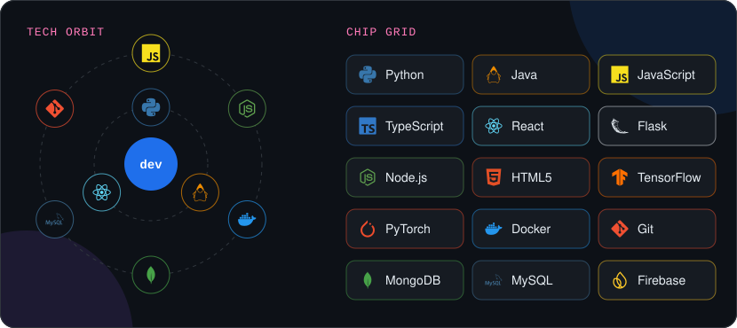
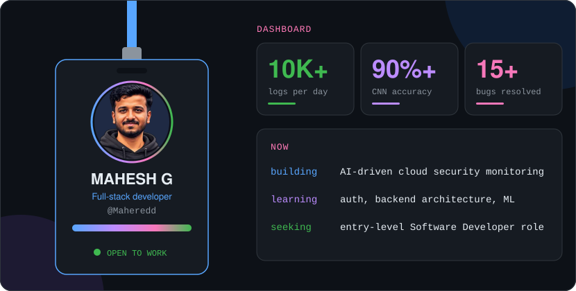
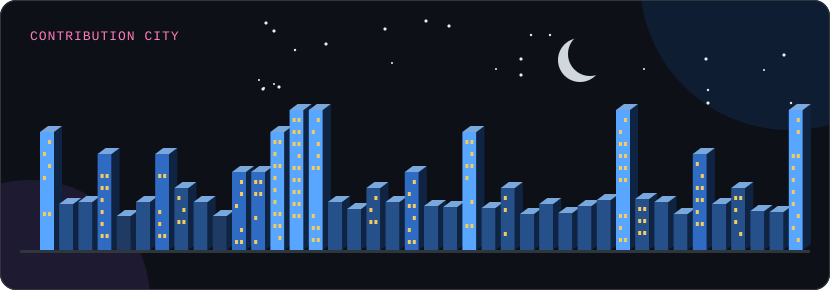
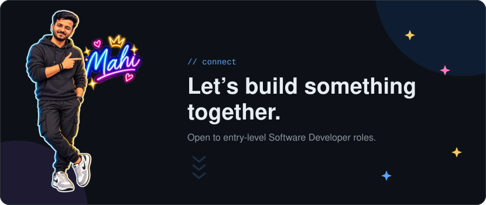

AI-integrated full-stack developer with hands-on experience building production-grade systems in Python, Java, React, and Flask. Built an AI-driven cloud security monitoring platform processing 10K+ logs/day with real-time anomaly detection, and a CNN-based computer vision system achieving 90%+ classification accuracy. Delivered client-facing features during a web development internship, resolving 15+ production bugs. Seeking an entry-level Software Developer role.

## Projects

| Project | What it does | Highlight |
| --- | --- | --- |
| AI cloud security monitoring platform | Watches cloud logs and flags anomalies in real time | 10K+ logs/day |
| CNN computer vision system | Classifies images with a convolutional neural network | 90%+ accuracy |
| Web development internship | Client-facing features and production fixes | 15+ bugs resolved |

